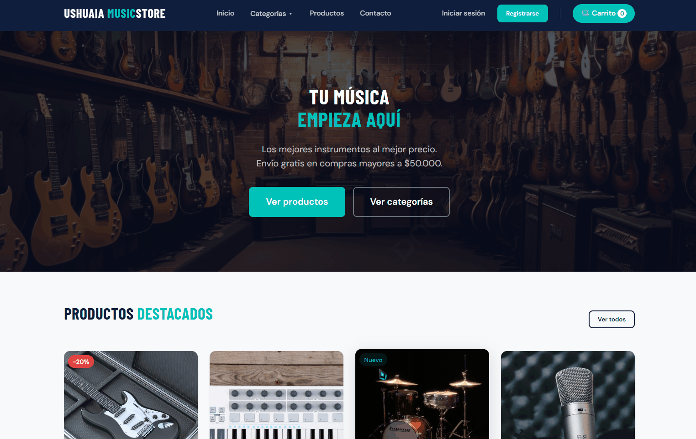
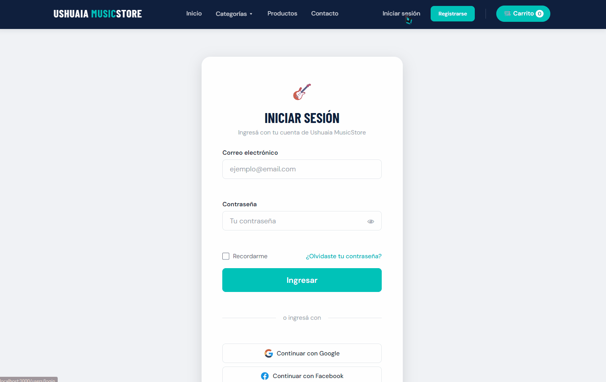

<h1 align="center">🎸 Ushuaia Music Store</h1>

<p align="center">
  E-commerce de instrumentos musicales con Node.js, Express, MySQL y un dashboard en React.
</p>

<p align="center">
  
  
  
  
  
  
</p>

Proyecto final del trayecto **Full Stack Developer** de Digital House. Es una tienda online completa: catálogo por categorías, carrito, registro e inicio de sesión, gestión de productos con carga de imágenes, API REST y un dashboard de estadísticas.

---

## 🎬 Demo

<!-- GIF principal: flujo completo de compra (home → producto → carrito). Ideal: 10-20 s, menos de 10 MB -->
<p align="center">
  
</p>

<table>
  <tr>
    <td align="center"><b>Catálogo</b><br></td>
    <td align="center"><b>Detalle de producto</b><br></td>
  </tr>
  <tr>
    <td align="center"><b>Carrito</b><br></td>
    <td align="center"><b>Registro y login</b><br></td>
  </tr>
  <tr>
    <td align="center"><b>Gestión de productos (admin)</b><br></td>
    <td align="center"><b>Dashboard React</b><br></td>
  </tr>
</table>

---

## ✨ Funcionalidades

**Tienda**
- Catálogo de productos y navegación por categorías (guitarras, teclados, baterías, micrófonos y accesorios).
- Página de detalle de cada instrumento.
- Carrito de compras.

**Usuarios**
- Registro e inicio de sesión con sesiones (`express-session`) y contraseñas encriptadas con `bcrypt`.
- Perfil de usuario y rutas protegidas según el rol: invitado, usuario y administrador.

**Administración**
- Alta, edición y baja de productos, con subida de imágenes (`Multer`).
- Validaciones en frontend y backend (`express-validator`) y mensajes al usuario con `connect-flash`.

**API REST y dashboard**
- API REST con endpoints de productos y usuarios.
- Dashboard en React (Vite) que consume la API: totales, último producto y usuario creados, categorías con su cantidad de productos y tabla de productos.

---

## 🧰 Tecnologías

| Capa | Tecnologías |
|------|-------------|
| Frontend | HTML5, CSS3, JavaScript, EJS, React (Vite) |
| Backend | Node.js, Express, express-session, bcrypt, Multer, connect-flash, express-validator, method-override |
| Base de datos | MySQL + Sequelize |
| Herramientas | Git / GitHub, GitHub Projects, nodemon |

---

## ▶️ Cómo correrlo

**Requisitos:** Node.js y MySQL instalados.

```bash
# 1. Clonar el repositorio
git clone https://github.com/Prof-NkoCussi/ecommerce-node-mysql.git
cd ecommerce-node-mysql

# 2. Instalar dependencias
npm install

# 3. Configurar variables de entorno
cp .env.example .env
# Editar .env con tus credenciales de MySQL

# 4. Crear la base de datos
# Ejecutar database/structure.sql (por ejemplo, desde MySQL Workbench)

# 5. Cargar datos de prueba
node database/seeders.js

# 6. Iniciar el servidor en modo desarrollo
npm run dev
```

La tienda queda disponible en **http://localhost:3000**.

**Dashboard (React):**

```bash
cd dashboard
npm install
npm run dev
```

El dashboard usa un proxy de Vite hacia la API de Express, por lo que el servidor del paso 6 debe estar corriendo.

> **Usuarios de prueba:** _(completar con el usuario administrador y el usuario común que crea `seeders.js`; usar solo credenciales de demostración)_

---

## 🔌 API REST

_(Completar con los endpoints reales de `src/routes/api.js`.)_

| Método | Endpoint | Descripción |
|--------|----------|-------------|
| GET | `/api/...` | ... |
| GET | `/api/...` | ... |

---

## 🗄️ Base de datos

Modelos Sequelize: `User`, `Product` y `Category`, con sus relaciones definidas en `database/models/index.js`.

<!-- Exportar el DER (database/der_ushuaia_musicstore.pdf) a imagen y guardarlo como docs/img/der.png -->
<p align="center">
  
</p>

El diagrama editable está en `database/der_ushuaia_musicstore.drawio`.

---

<details>
<summary><b>📁 Estructura del proyecto</b></summary>

```
ecommerce-node-mysql/
├── app.js                       # Servidor Express
├── package.json
├── .env.example                 # Plantilla de variables de entorno
│
├── dashboard/                   # Dashboard React (Vite)
│   └── src/components/          # StatCard, LastCreated, CategoryList, ProductTable
│
├── database/
│   ├── config.js                # Conexión Sequelize a MySQL
│   ├── structure.sql            # Creación de tablas
│   ├── seeders.js               # Datos de prueba
│   ├── der_ushuaia_musicstore.* # Diagrama DER
│   └── models/                  # Category, Product, User
│
├── public/                      # Estáticos (imágenes y estilos)
│
├── src/
│   ├── controllers/             # index, products, users, api
│   ├── middlewares/             # auth, multerConfig, validations
│   ├── routes/                  # index, products, users, api
│   └── views/                   # Vistas EJS (home, products, users, partials)
│
├── Views/                       # Prototipos HTML estáticos (Sprint 2)
├── wireframes/                  # Wireframes (Sprint 1)
├── data/                        # Datos JSON de etapas previas (reemplazados por MySQL)
└── retro.md                     # Retrospectiva
```

</details>

<details>
<summary><b>🚀 Proceso de desarrollo (8 sprints)</b></summary>

El proyecto se desarrolló de forma incremental y se organizó con [GitHub Projects](URL_DEL_TABLERO).

| Sprint | Descripción |
|--------|-------------|
| 1 | Planificación, wireframes y README |
| 2 | Maquetado HTML y CSS |
| 3 | Node.js + Express + EJS |
| 4 | CRUD con archivos JSON |
| 5 | Usuarios y autenticación |
| 6 | Base de datos MySQL + Sequelize |
| 7 | Validaciones en frontend y backend |
| 8 | API REST + Dashboard React |

Los wireframes están en la carpeta [`wireframes/`](wireframes) y la retrospectiva en [`retro.md`](retro.md).

</details>

<details>
<summary><b>🎯 Público objetivo y sitios de referencia</b></summary>

El sitio apunta a jóvenes y adultos interesados en la música: desde quienes buscan su primer instrumento hasta músicos aficionados y profesionales que quieren ampliar su equipamiento.

Para el diseño y la experiencia de compra se tomaron como referencia [Mercado Libre](https://www.mercadolibre.com.ar), [Get Back](https://www.get-back.com.ar), [SDQ Store](https://www.sdqstore.com.ar), [The Rock Store](https://therockstore.com.ar) y [Centro Música](https://centromusica.com.ar).

</details>

---

## 👤 Autor

**Nicolás Cussi**: Full Stack Developer en formación (Digital House).
Realicé este trayecto como un desafío personal y profesional, para incorporar nuevas tecnologías y aplicar en la práctica lo aprendido.

<!-- Agregar acá tu LinkedIn y/o contacto -->
